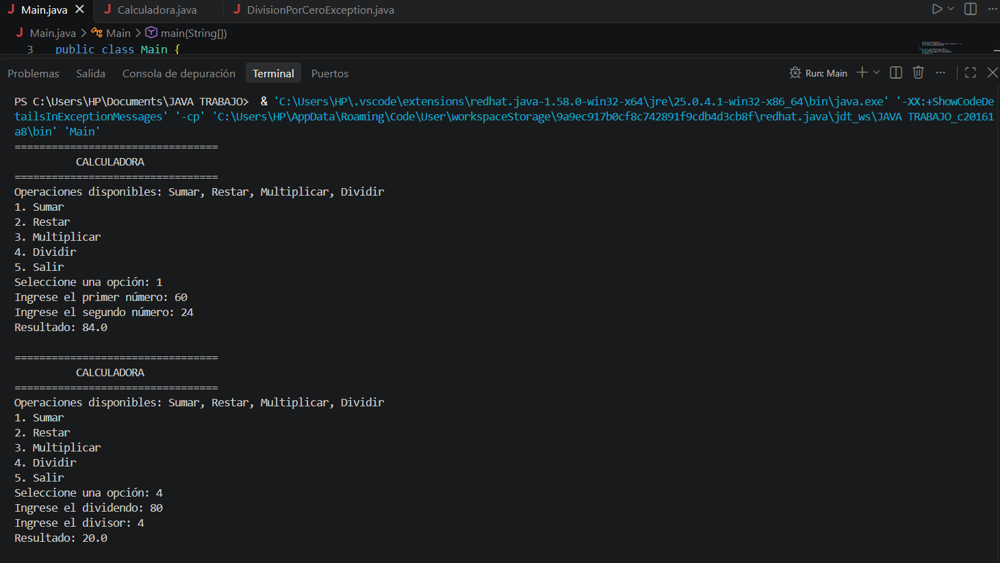
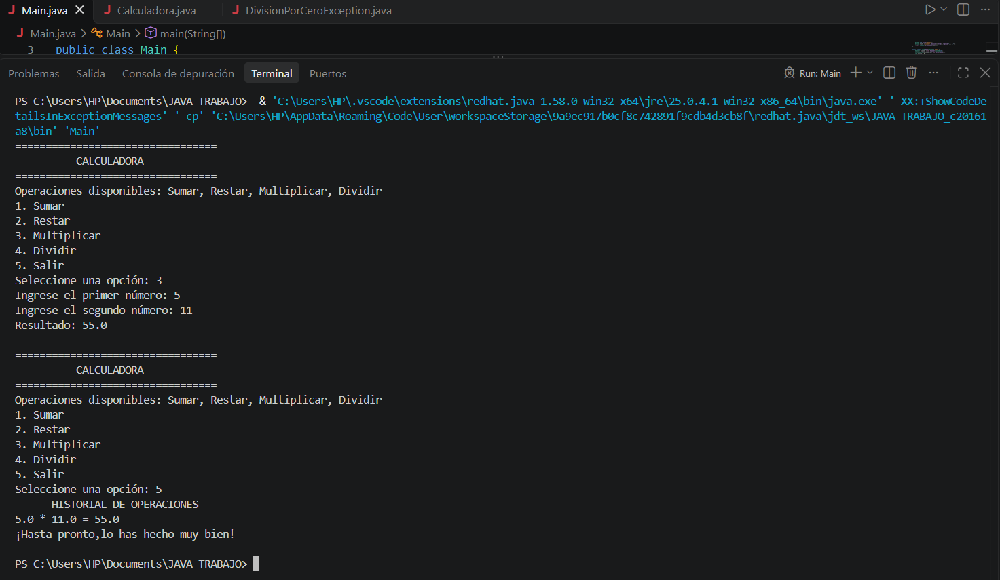

# Calculadora en Java

**Estudiante:** SANTIAGO BATISTA BETANCOURT- 54448

## Descripción
Aplicación de consola en Java que simula una calculadora básica, controlada desde un menú. La información se guarda en memoria.

## Funcionalidades
- Sumar, restar y multiplicar dos números
- Dividir, controlando la división entre cero
- Historial de operaciones que se muestra al salir
- Validación de entradas inválidas en el menú

## Clases utilizadas
- `Main`: menú por consola
- `Calculadora`: operaciones, arreglo de operaciones disponibles e historial (ArrayList)
- `DivisionPorCeroException`: excepción personalizada

## Conceptos de POO aplicados
Clases y objetos, atributos y métodos, encapsulamiento (atributos privados con getters y setters), arreglos, listas y su recorrido, try-catch y excepción personalizada.

## Instrucciones para ejecutar
1. Instalar el JDK 17 o superior.
2. Descargar o clonar el repositorio.
3. Abrir la carpeta en Visual Studio Code con Extension Pack for Java.
4. Ejecutar `Main.java`.

## Evidencia

